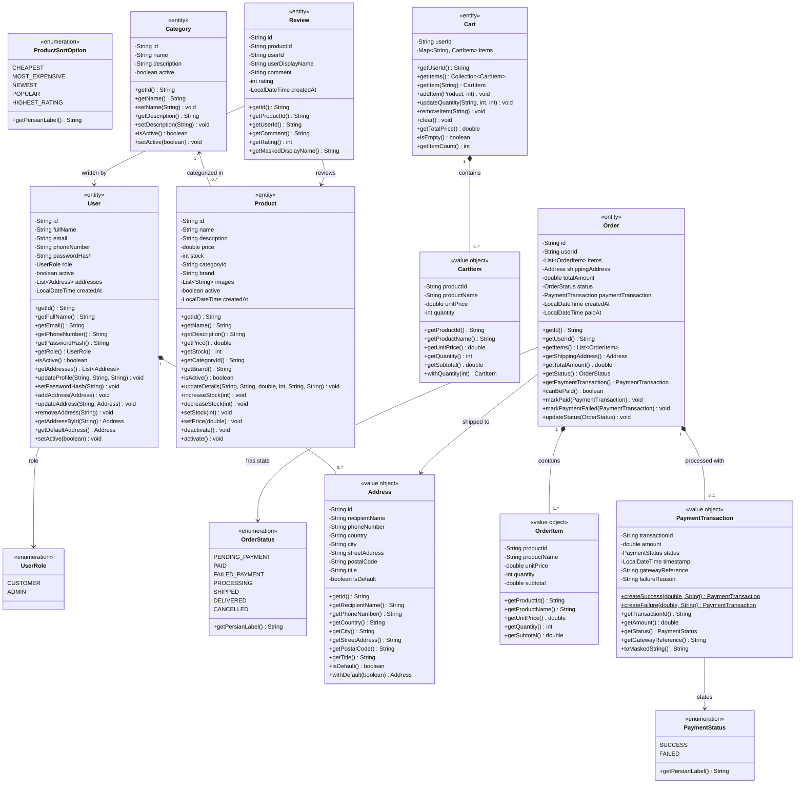
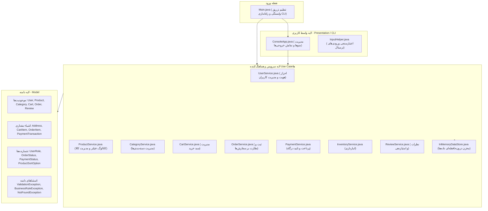

# مستند جامع مدل دامنه (Domain Model) و معماری نرم‌افزار
## پروژه درس اصول طراحی نرم‌افزار — بخش دوم فاز ۱
**دانشگاه صنعتی امیرکبیر (پلی‌تکنیک تهران)**  
**استاد:** سرکار خانم دکتر هانیه فلاح | **سر تدریسیار:** جناب آقای امیرمحمد ذاکر  

---

## ۱. مقدمه و هدف
در بخش اول فاز ۱، با تحلیل ۳۶ داستان کاربری (User Story) در ۱۱ حوزه عملکردی، نمودارهای Domain Story رسم شدند که نقش‌ها (Actors)، اشیاء کاری (Work Objects) و فعالیت‌ها (Activities) را با شماره توالی مشخص کردند.
در این بخش (بخش دوم فاز ۱)، تمامی این مفاهیم و فرآیندها به یک **مدل دامنه شیءگرا (Domain Model)** تبدیل شده و به صورت کاملاً ماژولار و ساختاریافته در قالب یک معماری چندلایه‌ای در زبان جاوا پیاده‌سازی گردیده است.

---

## ۲. تفکیک مفاهیم دامنه (Domain Concepts)

بر اساس اصول طراحی دامنه-محور (DDD) و شیءگرایی، مفاهیم سیستم به دو دسته اصلی تفکیک شده‌اند:

### ۲.۱. موجودیت‌ها (Entities)
اشیایی که دارای **شناسه منحصر‌به‌فرد (Identity)** و چرخه حیات (Lifecycle) هستند و تغییر ویژگی‌های آن‌ها هویتشان را تغییر نمی‌دهد:

| نام موجودیت | شناسه (ID) | توضیحات و منطق دامنه |
|---|---|---|
| **User** | `id: String (UUID)` | نماینده کاربران سامانه (مشتری یا مدیر). مدیریت پروفایل، رمز عبور هش‌شده و مجموعه آدرس‌ها. |
| **Product** | `id: String (UUID)` | کالای فروشگاه. دارای قیمت، موجودی، برند، وضعیت فعال/غیرفعال و قوانین تغییر موجودی. |
| **Category** | `id: String (UUID)` | دسته‌بندی موضوعی کالاها برای طبقه‌بندی و ناوبری کاتالوگ فروشگاه. |
| **Cart** | `userId: String` | سبد خرید مشتری (Aggregate Root). تجمیع‌کننده اقلام انتخابی کاربر و محاسبه مبلغ کل. |
| **Order** | `id: String (UUID)` | سفارش ثبت‌شده مشتری (Aggregate Root). دارای وضعیت سفارش، آدرس تحویل، اقلام قطعی و تراکنش پرداخت. |
| **Review** | `id: String (UUID)` | نظر و امتیاز ثبت‌شده برای کالا. مشروط به خرید قبلی کالا توسط مشتری با نام ماسک‌شده. |

### ۲.۲. اشیاء مقداری (Value Objects)
اشیایی که فاقد هویت مستقل هستند، بر اساس **مقادیر ویژگی‌هایشان** شناخته می‌شوند و تغییرناپذیر (Immutable) طراحی شده‌اند:

| نام شیء مقداری | ویژگی‌های کلیدی | علت انتخاب به عنوان Value Object |
|---|---|---|
| **Address** | recipientName, phoneNumber, country, city, streetAddress, postalCode, title, isDefault | آدرس هویت مستقل ندارد و مشخصاتی از محل ارسال کالا است. برابری دو آدرس بر مبنای برابری تمامی فیلدها سنجیده می‌شود. |
| **CartItem** | productId, productName, unitPrice, quantity, subtotal | سطر کالای درون سبد خرید. وابسته به سبد بوده و با تغییر تعداد یا قیمت، ارزش آن تعریف می‌شود. |
| **OrderItem** | productId, productName, unitPrice, quantity, subtotal | تصویر لحظه‌ای (Snapshot) و تغییرناپذیر از کالای خریداری‌شده در زمان ثبت سفارش. |
| **PaymentTransaction** | transactionId, amount, status, timestamp, gatewayReference, failureReason | سند پرداخت شامل کد پیگیری درگاه و وضعیت تراکنش، بدون چرخه حیات مستقل از سفارش. |

### ۲.۳. مقادیر شمارشی (Enums)
- **`UserRole`**: نقش‌های کاربری (`CUSTOMER`, `ADMIN`).
- **`OrderStatus`**: چرخه وضعیت سفارش (`PENDING_PAYMENT`, `PAID`, `FAILED_PAYMENT`, `PROCESSING`, `SHIPPED`, `DELIVERED`, `CANCELLED`).
- **`PaymentStatus`**: وضعیت تراکنش بانکی (`SUCCESS`, `FAILED`).
- **`ProductSortOption`**: گزینه‌های مجاز مرتب‌سازی کالا (`CHEAPEST`, `MOST_EXPENSIVE`, `NEWEST`, `POPULAR`, `HIGHEST_RATING`).

---

## ۳. تعیین ارتباطات و تعدد (Relationships & Multiplicity)

### ۳.۱. جدول روابط و کاردینالیتی بین کلاس‌ها

| کلاس مبدأ | کلاس مقصد | نوع رابطه | کاردینالیتی (تعدد) | جهت | توضیحات |
|---|---|---|---|---|---|
| **User** | **Address** | Composition | `1` به `0..*` | یک‌طرفه (User -> Address) | هر کاربر می‌تواند چندین آدرس داشته باشد. با حذف کاربر یا آدرس، آدرس وابسته به کاربر است. |
| **User** | **UserRole** | Association | `*` به `1` | یک‌طرفه | هر کاربر دقیقاً یک نقش اصلی دارد. |
| **Category** | **Product** | Aggregation | `1` به `0..*` | یک‌طرفه (Product -> Category) | هر محصول به یک دسته‌بندی تعلق دارد؛ با حذف دسته‌بندی، هویت محصول مستقل است. |
| **Cart** | **CartItem** | Composition | `1` به `0..*` | یک‌طرفه (Cart -> CartItem) | سبد خرید شامل سطرهای کالاست. طول عمر اقلام به سبد وابسته است. |
| **Order** | **OrderItem** | Composition | `1` به `1..*` | یک‌طرفه (Order -> OrderItem) | هر سفارش باید حداقل یک سطر سفارش داشته باشد. |
| **Order** | **Address** | Aggregation / Value Object | `*` به `1` | یک‌طرفه (Order -> Address) | سفارش آدرس ارسال را در لحظه خرید ثبت می‌کند. |
| **Order** | **OrderStatus** | Association | `*` به `1` | یک‌طرفه | وضعیت سفارش را نشان می‌دهد. |
| **Order** | **PaymentTransaction** | Composition / Value Object | `1` به `0..1` | یک‌طرفه | سفارش حداکثر یک تراکنش پرداخت نهایی را نگهداری می‌کند. |
| **Product** | **Review** | Aggregation | `1` به `0..*` | یک‌طرفه (Review -> Product) | هر نظر متعلق به یک کالا است. |
| **User** | **Review** | Association | `1` به `0..*` | یک‌طرفه (Review -> User) | هر نظر توسط یک مشتری خریدار ثبت می‌شود. |

---

## ۴. نمودار کلاس UML (Class Diagram)

---

## ۵. نگاشت فعالیت‌ها و رفتارها (Activities & Behaviors)
در جدول زیر، تمامی ۳۶ داستان کاربری و رفتارهای مدل‌شده در Domain Storyهای فاز ۱، به متدها و کلاس‌های لایه‌های مختلف نگاشت داده شده‌اند:

| شماره داستان کاربری | عنوان داستان کاربری | فعالیت در Domain Story | کلاس و متد پیاده‌سازی شده | لایه معماری |
|---|---|---|---|---|
| **US 1** | ثبت‌نام | وارد کردن ایمیل/موبایل و رمز، اعتبارسنجی یکتایی، ذخیره رمز هش | `UserService.register(...)` | Service / Model |
| **US 2** | ورود | اعتبارسنجی ورود، انطباق رمز عبور هش‌شده | `UserService.login(...)` | Service |
| **US 3** | خروج | قطع دسترسی کاربر و پاکسازی سشن | `ConsoleApp.logout(...)` | CLI |
| **US 4** | فراموشی رمز عبور | بررسی وجود تماس، ثبت رمز عبور هش‌شده جدید | `UserService.resetPassword(...)` | Service |
| **US 5** | مشاهده پروفایل | بازیابی داده پروفایل بدون نمایش رمز عبور | `UserService.getProfile(...)` | Service / CLI |
| **US 6** | ویرایش پروفایل | اعتبارسنجی فیلدهای غیرخالی و به‌روزرسانی | `UserService.updateProfile(...)` | Service |
| **US 7** | مدیریت آدرس | افزودن، ویرایش، حذف و مدیریت آدرس پیش‌فرض | `User.addAddress(...)`, `updateAddress(...)`, `removeAddress(...)` | Model / Service |
| **US 8** | مشاهده کاتالوگ | بازیابی و فیلتر فقط کالاهای فعال و معتبر | `ProductService.getActiveProducts()` | Service |
| **US 9** | مشاهده جزئیات محصول | بررسی وجود، نمایش ویژگی‌ها، امتیاز و نظرات | `ProductService.getProductById(...)` | Service |
| **US 10** | جستجوی کالا | اعتبارسنجی طول عبارت (<=100)، فیلتر کلمات | `ProductService.searchProducts(query)` | Service |
| **US 11** | فیلتر کالاها | کنترل بازه قیمت، امتیاز ۱ تا ۵ و موجودی | `ProductService.filterProducts(...)` | Service |
| **US 12** | مرتب‌سازی کالاها | سورت بر اساس گزینه‌های مجاز پنج‌گانه | `ProductService.sortProducts(...)` | Service |
| **US 13** | مشاهده دسته‌بندی‌ها | فیلتر دسته‌بندی‌های فعال با نام معتبر | `CategoryService.getActiveCategories()` | Service |
| **US 14** | محصولات یک دسته | اعتبارسنجی وجود دسته و نمایش اقلام فعال آن | `ProductService.getProductsByCategory(...)` | Service |
| **US 15** | افزودن به سبد خرید | بررسی فعال و موجود بودن، افزایش تعداد در تکرار | `Cart.addItem(...)`, `CartService.addToCart(...)` | Model / Service |
| **US 16** | مشاهده سبد خرید | محاسبه خودکار مبلغ کل توسط سیستم | `Cart.getTotalPrice()`, `CartService.getOrCreateCart(...)` | Model / Service |
| **US 17** | تغییر تعداد در سبد | اعتبارسنجی حداقل ۱ و عدم تجاوز از موجودی کالا | `Cart.updateQuantity(...)` | Model / Service |
| **US 18** | حذف کالا از سبد | حذف سطر کالای مشخص از سبد کاربر | `Cart.removeItem(...)` | Model / Service |
| **US 19** | خالی کردن سبد خرید | پاکسازی کامل اقلام و صفر شدن تعداد و مبلغ | `Cart.clear()` | Model / Service |
| **US 20** | شروع فرایند خرید | بررسی خالی نبودن سبد، موجودی کالا و محاسبه مبلغ | `OrderService.checkout(...)` | Service |
| **US 21** | انتخاب آدرس تحویل | اعتبارسنجی تعلق داشتن آدرس به کاربر | `OrderService.checkout(...)` | Service |
| **US 22** | مشاهده مبلغ نهایی | نمایش پیش‌فاکتور محاسبه‌شده بدون امکان دستکاری | `OrderService.checkout(...)`, `Order.getTotalAmount()` | Model / CLI |
| **US 23** | پرداخت سفارش | پرداخت هزینه، کسر از انبار، ثبت وضعیت PAID | `PaymentService.processPayment(...)` | Service |
| **US 24** | پرداخت ناموفق | حفظ سفارش در وضعیت قابل پرداخت، امکان تلاش مجدد | `Order.markPaymentFailed(...)` | Model / Service |
| **US 25** | تأیید پرداخت | انطباق مبلغ، پیشگیری از پرداخت دوباره (Idempotency) | `PaymentService.verifyAndConfirmPayment(...)` | Service |
| **US 26** | مشاهده سفارش‌ها | لیست سفارش‌های کاربر به همراه وضعیت شفاف | `OrderService.getCustomerOrders(...)` | Service |
| **US 27** | جزئیات سفارش | کنترل دسترسی فقط به سفارش خود، نمایش اقلام و آدرس | `OrderService.getOrderDetails(...)` | Service |
| **US 28** | مشاهده موجودی کالا | دسترسی مدیر به گزارش دقیق موجودی انبار | `InventoryService.getInventoryList()` | Service |
| **US 29** | تغییر موجودی کالا | افزایش یا کاهش انبار و ممانعت از منفی شدن موجودی | `InventoryService.adjustStock(...)`, `Product.decreaseStock(...)` | Model / Service |
| **US 30** | ثبت نظر | شرط خرید قبلی کالا، کنترل طول متن (<=500) | `ReviewService.addReview(...)` | Service / Model |
| **US 31** | امتیاز دادن | شرط خرید قبلی، کنترل امتیاز بین ۱ تا ۵ | `ReviewService.submitRatingOnly(...)`, `Review` | Service / Model |
| **US 32** | مشاهده نظرات | نمایش نظرات تاییدشده با ماسک کردن نام نویسنده | `Review.getMaskedDisplayName()`, `ReviewService.getProductReviews(...)` | Model / Service |
| **US 33** | ایجاد کالا (مدیر) | کنترل نام، قیمت نامنفی، موجودی و دسته‌بندی معتبر | `ProductService.createProduct(...)` | Service |
| **US 34** | ویرایش کالا (مدیر) | به‌روزرسانی مشخصات کالای موجود | `ProductService.updateProduct(...)` | Service |
| **US 35** | غیرفعال‌سازی کالا | ممانعت از خرید در عین حفظ تاریخچه سفارش‌های قبلی | `Product.deactivate()`, `ProductService.deactivateProduct(...)` | Model / Service |
| **US 36** | مدیریت سفارش‌ها | مشاهده تمام سفارش‌ها، فیلتر وضعیت و ماسک اطلاعات پرداخت | `OrderService.getAllOrdersForAdmin(...)`, `PaymentTransaction.toMaskedString()` | Service / Value |

---

## ۶. معماری لایه‌بندی سیستم (Layered Architecture)

سیستم به صورت صریح به چهار لایه مستقل تفکیک شده است:

### استقلال لایه Model:
لایه مدل هیچ‌گونه وابستگی به لایه‌های بالاتر (سرویس، CLI، پایگاه داده خارجی) ندارد. این استقلال تضمین می‌کند که قوانین دامنه مستقل از نحوه نمایش یا ذخیره‌سازی، پایدار و تست‌پذیر باقی می‌مانند.
